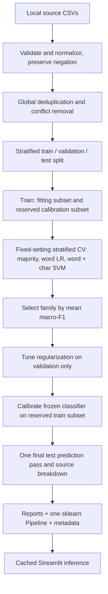
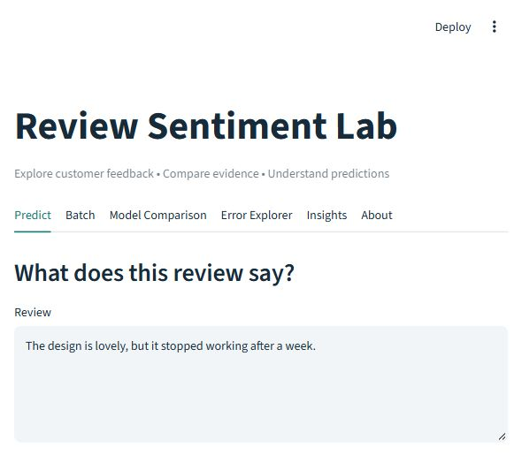
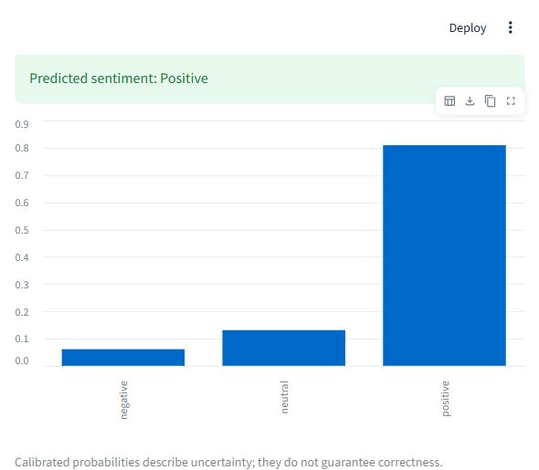
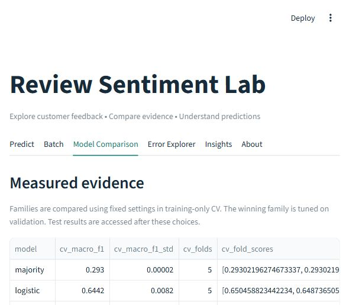

# Review Sentiment Lab

A CPU-friendly, reproducible Amazon review sentiment classifier: **negative / neutral / positive**. Explore individual predictions, batch reviews, model comparisons, confident mistakes and linear explanations in Streamlit.

## Problem and data

Product feedback contains mixed opinions and ambiguous rating-derived sentiment. This project supports human review triage and makes evaluation evidence inspectable. It does not claim business impact or production readiness.

Supply these local files in `data/raw/` (raw data is not redistributed):

- `Amazon_Food_Reviews.csv`: `Text`, `Score`; [Amazon Fine Food Reviews](https://www.kaggle.com/datasets/snap/amazon-fine-food-reviews).
- `Datafiniti_Amazon_Consumer_Reviews_of_Amazon_Products_May19.csv`: `reviews.text`, `reviews.rating`; [Datafiniti consumer reviews](https://www.kaggle.com/datasets/datafiniti/consumer-reviews-of-amazon-products).

Low ratings map to negative, the middle rating to neutral, and high ratings to positive; the exact mapping lives in `src/data.py`. The Datafiniti source is labeled `consumer-electronics` for the domain breakdown, although its product scope may extend beyond electronics. Source file hashes, row counts, exclusions and class distributions are generated in `reports/metrics.json`.

All sources are combined before normalized-text deduplication. Conflicting-label duplicate groups are removed entirely. A duplicate shared by sources is attributed to the first source supplied. Sampling, when explicitly requested, occurs after deduplication and retains natural class imbalance.

## Approach



The exact seed, split ratios, calibration fraction, feature limits and grids are in [the configuration](configs/default.yaml). The default uses all cleaned reviews. Train/validation/test use the requested stratified split; rounding can shift a row for small datasets. Calibration is reserved **inside training**, so CV uses only its fitting subset. Each CV fold fits its own vocabulary and IDF. The comparison reports mean macro-F1 and fold standard deviation at fixed regularization; only the selected family's regularization is tuned on validation. Validation-only ablations cross negation-safe stopword handling with unigram/bigram features and are descriptive, not another test-selection loop.

Both learned linear estimators use `class_weight="balanced"`; no class is downsampled to another class's size. Sigmoid calibration uses `CalibratedClassifierCV` with a frozen fitted classifier and an independent training calibration subset. Test predictions are computed once, then reused for every aggregate, source slice, plot and error sample. The `evaluate` command renders existing evidence; it never runs another test evaluation. Existing reports cannot be overwritten by training: choose fresh output paths for another experiment and document prior test exposure.

## Generated results

This block is generated from `reports/metrics.json` by `python -m src.evaluate --reports reports --update-readme README.md`. No handwritten performance values belong here.

<!-- RESULTS:START -->
Selected model: **logistic**.

| Test population | Macro-F1 (95% CI) | Majority macro-F1 | Accuracy (95% CI) | Majority accuracy | Support |
|---|---:|---:|---:|---:|---|
| All | 0.6140 [0.5928, 0.6362] | 0.2930 | 0.8636 [0.8531, 0.8733] | 0.7840 | 4500 |
| consumer-electronics | 0.4831 [0.3179, 0.6665] | 0.3199 | 0.9227 [0.8840, 0.9558] | 0.9227 | 181; **low support** |
| food | 0.6149 [0.5940, 0.6353] | 0.2918 | 0.8611 [0.8509, 0.8710] | 0.7782 | 4319 |

| Model | Training CV macro-F1 | Fold SD |
|---|---:|---:|
| majority | 0.2930 | 0.0000 |
| logistic | 0.6442 | 0.0082 |
| linear_svc | 0.6289 | 0.0104 |

| Class | Precision | Recall | F1 |
|---|---:|---:|---:|
| negative | 0.7342 | 0.6364 | 0.6818 |
| neutral | 0.4950 | 0.1497 | 0.2299 |
| positive | 0.8918 | 0.9722 | 0.9303 |

Run sample cap: 30000. Split counts: `{'train': 21000, 'val': 4500, 'test': 4500, 'fit': 16800, 'calibration': 4200}`.
CV uses the fitting portion of training; calibration examples are excluded from selection.
<!-- RESULTS:END -->

[Comparison CSV](reports/comparison.csv) · [Validation ablations](reports/ablation.csv) · [Machine-readable metrics](reports/metrics.json) · [Model card](docs/MODEL_CARD.md)


Fold SD is descriptive, not a confidence interval. Source slices are within-mixture evaluations, not a train-on-food/test-on-electronics transfer experiment. Calibration is assessed on test; it is not assumed perfect. Optional transformer results are a separate subset experiment and do not replace the sklearn serving artifact.

## Run locally

Use Python matching the pinned dependency environment (see metadata for the measured run). From the repository root:

```powershell
python -m venv .venv
.\.venv\Scripts\Activate.ps1
python -m pip install -r requirements-dev.txt
python -m pip check
python -m pytest -q
python -m ruff check .
python -m streamlit run app.py
```

On Linux/macOS activate with `source .venv/bin/activate`. The included trusted pipeline supports inference without raw data. **The app never trains during startup**; it caches artifact loading and displays recovery instructions for missing, corrupt or version-mismatched files.

Offline training, after supplying source data:

```bash
python -m src.train --config configs/default.yaml
```

For the explicit fast-run protocol used by the generated report, add `--max-samples 30000`. To reproduce while preserving the included evidence, use a copied config with fresh model/report paths:

```bash
python -m src.train --config configs/reproduce.yaml --max-samples 30000
python -m src.evaluate --reports reports/reproduction
```

To regenerate the README from the included report:

```bash
python -m src.evaluate --reports reports --update-readme README.md
```

`make train`, `make evaluate`, `make app`, `make test`, and `make lint` wrap the corresponding commands. `SENTIMENT_MODEL_DIR` and `SENTIMENT_REPORTS_DIR` can point the app at another matching run. Model hashes prevent reporting results from a different artifact.

### Optional transformer

```bash
python -m pip install -r requirements-transformer.txt
python -m src.train --config configs/transformer.yaml --transformer --max-samples 30000
```

This downloads `distilbert-base-uncased`, uses Hugging Face Trainer on CPU, retains natural class proportions in a configurable training subset, and uses inverse-frequency loss weights. Validation selects the checkpoint; test is predicted once. Model weights are stored separately under the configured model directory's `transformer/` folder. Metrics use the same accuracy, macro-F1 and per-class schema and appear in the comparison. This optional path has not been fine-tuned in the delivered run; no transformer performance is claimed. [Trainer API reference](https://huggingface.co/docs/transformers/en/main_classes/trainer).

### Docker

```bash
docker build -t review-sentiment-lab .
docker run --rm -p 8501:8501 review-sentiment-lab
```

Open the displayed local Streamlit URL. The build includes the pipeline and generated reports; raw CSVs and private error samples are excluded. Docker was not available in the implementation environment, so the container build remains unverified.

## App and screenshots

- **Predict:** calibrated probability bars, a configurable uncertainty warning and highlighted word contributions.
- **Batch:** validated CSV input, tabular results, unknown-vocabulary abstention and formula-safe CSV export.
- **Model Comparison:** generated CV results, test metrics, source breakdown, ablations and calibration plot.
- **Error Explorer:** generated most-confident errors, filtered by true/predicted label, source and confidence.
- **Insights:** supporting and opposing n-grams for each class.
- **About:** scope, limitations and downloadable model card.





The mixed-review screenshot shows a real failure on an illustrative input. Screenshots
demonstrate the UI, not additional benchmark evidence.

## Structure and verification

`src/` separates configuration, data, negation-safe preprocessing, features, offline training, reporting, explanation, inference and UI. `app.py` is a thin cached-loading entry point. `notebooks/01_eda.ipynb` explores the training partition only and contains no model fitting, saving, installation or Colab code. The original notebook remains recoverable from Git history; the original course report is retained for attribution, not current evidence.

`tests/` covers negation, deduplication and split disjointness, report generation, artifact integrity, calibrated prediction schemas, explanation fidelity, CSV validation, app loading and the tab flows. CI installs pinned dependencies and runs pytest, dependency checks and Ruff. Synthetic fixtures test contracts only; their results are never published as portfolio metrics.

Generated review-level predictions and error samples remain local and ignored by Git. They may contain sensitive review text. Aggregate reports and figures are versioned. Only load trusted joblib files; hashes verify matching files but do not make pickle safe.

## Limitations and future work

Sarcasm, aspect-specific opinions, neutral ambiguity, unseen vocabulary, multilingual text and domain shift remain failure modes. Exact deduplication does not remove all near duplicates or product/author/time overlap. Class weighting and calibration do not remove dataset bias. Confidence is not correctness, and the abstention rule is not a complete out-of-distribution detector.

Next work: grouped and temporal evaluation; near-duplicate detection; neutral-label adjudication; aspect sentiment; calibration uncertainty; monitored human feedback. Validate the optional transformer before making comparative claims. Hosted deployment and the Docker build are not verified.

Original course project: **Iqra Nawaz, Sameen Fatima and Laiba Nadeem**.
