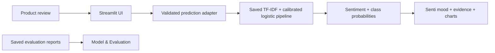
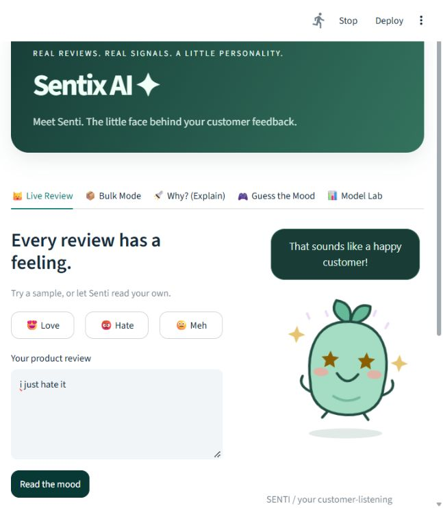
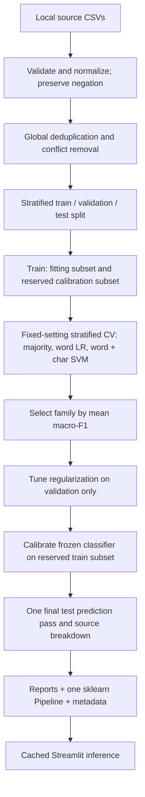
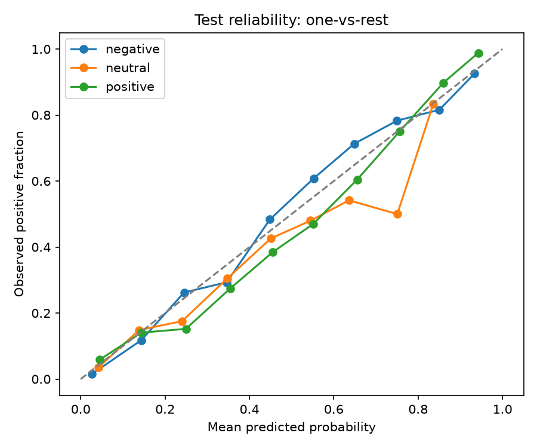
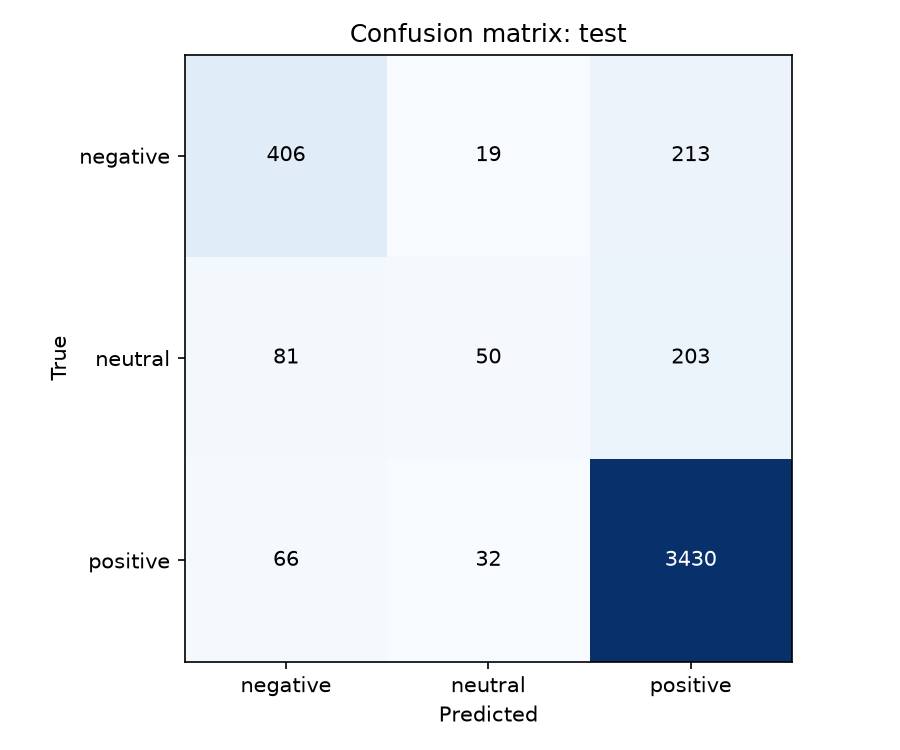

<div align="center">

# 🌱 Sentix AI
### Meet Senti — turning customer reviews into insights, one mood at a time.

**A sentiment analysis experience that makes machine learning interactive, visual, and explainable.**


*Read a review. Understand its mood. Explore the evidence.*

[Features](#-at-a-glance) · [Quick start](#-quick-start) · [Model results](#generated-results) · [Deep Mode](#optional-deep-mode-approved-int8-hybrid) · [Limitations](#limitations-and-future-work)

</div>

---

## ✨ The idea

Customer reviews are full of opinions, but thousands of comments can be hard to interpret one by one. **Sentix AI** helps explore product sentiment through a real trained NLP model, an interactive Streamlit interface, and **Senti**, an original animated seed character whose mood reflects the model's output.

It goes beyond a simple *positive / neutral / negative* label: you can inspect calibrated class probabilities, explore word-level evidence, analyze CSV files in batches, and check the model's evaluation results. When evidence is insufficient, the system can say **unavailable** instead of inventing a prediction.

> **Built for learning and human review, not as a claim of production-ready sentiment intelligence.** The original project's model, evaluation protocol, and limitations remain documented below.

## ⚡ At a glance

| Experience | What you can do |
|:--|:--|
| 📋 **Overview** | See KPI cards, the sentiment mix, evidence-based insights, trends (when dates exist), and stars vs predicted sentiment for the active dataset |
| 🗨️ **Review Analyzer** | Paste a review and see its sentiment, confidence, three-class probabilities, and Senti's animated reaction |
| 🔎 **Review Explorer** | Search, filter, sort, and page through reviews, open full details, and export the filtered rows |
| 📂 **Batch Analysis** | Analyze a selected CSV text column (up to 5,000 rows by default), map optional rating/date/product columns, and export formula-safe results |
| 🔍 **Explain** | Inspect contributing words using the linear TF-IDF model's score evidence, with optional LIME/fallback |
| 🎮 **Guess the Mood** | A practice game: guess a real review's star-rating sentiment and compare with the model |
| 📊 **Model & Evaluation** | Examine model information, saved accuracy, macro-F1, a majority baseline, per-class scores, and a confusion matrix |
| 🕘 **History** | Revisit reviews analyzed in this browser session (not saved to disk) |
| 🧠 **Optional Deep Mode** | Route lower-confidence Fast predictions through a frozen int8 transformer: better on neutral reviews, worse on negative ones, not better overall (measured below) |

**Recommended showcase:** capture the Review Analyzer with Senti reacting, the Overview with the sample dataset loaded, the Explain panel, and Model & Evaluation. Keep screenshots as demonstrations; use the generated reports for measured model performance.

## 🚀 Quick start

Use **Python 3.14** and the pinned dependencies supplied with this repository. From the project root in PowerShell:

```powershell
python -m venv .venv
.\.venv\Scripts\Activate.ps1
python -m pip install -r requirements-dev.txt
python -m pytest -q -p no:cacheprovider
python -m streamlit run app.py --browser.gatherUsageStats false
```

Open the localhost link printed in the terminal. **Fast Mode** works with the included trusted model artifacts and does not require raw training CSVs or an internet connection after dependencies are installed. Additional installation, reproducibility, and optional Deep Mode instructions appear later.

## 🧩 How it works



**Fast Mode** serves a saved, three-class calibrated logistic-regression pipeline using word TF-IDF unigrams and bigrams. The interface **loads** the trained pipeline; it does not retrain it during user interaction. Optional Deep Mode is a distinct, conditional inference path with separate limitations.

## 📈 Measured results — context matters

The included evaluation report lists **86.36% test accuracy** and **0.6140 macro-F1** for the Fast model on **4,500 reviews**. Neutral-class performance is substantially weaker than positive-class performance; accuracy alone should not be interpreted as uniform performance across sentiments.

These are values reported in the existing generated metrics block below—not fresh measurements. The [model card](docs/MODEL_CARD.md) and full [metrics](reports/metrics.json) provide the evaluation context, including class imbalance and domain slices.

---

## 🎭 Explore the Senti experience

The sidebar groups eight pages as links (Analyze: Overview, Review Analyzer, Review Explorer, Batch Analysis, History; Model: Explain, Model & Evaluation; Practice: Guess the Mood). The active page is highlighted and mirrored in the URL (`?page=model-evaluation`), so pages can be bookmarked. The sidebar collapses behind a menu button on phones. Fast/Deep Mode and the optional Senti companion are chosen in the sidebar; the page header shows the current mode and active dataset.

- **Overview:** KPI cards for the *active dataset*: reviews analyzed, positive/neutral/negative shares (denominator: analyzed rows only), mean predicted-class probability, tentative predictions, Product Mood Score and average rating. Below them: a sentiment distribution chart with a text summary, evidence-based insights that each state their sample size, sentiment over time (only when a real date column is mapped), ratings vs predicted sentiment with star/text disagreements (only when a rating column is mapped), a certainty histogram, the first or most recent reviews, and a data-and-model status panel (records, model version, which evaluations are saved, data warnings). Without dates, the trend panel shows sentiment by category, or by review length, instead. Theme extraction is not implemented, so no themes are shown.
- **Review Analyzer** (formerly Live Review): review input with Analyze and Clear; three example buttons that only fill the text box; a results panel with separate empty, analyzed, not-analyzed and error states; a direction-icon verdict badge, class-colored probabilities, the decision rule and any uncertainty reasons, model version, mode and measured time; copy-result and report-incorrect actions (feedback is kept with the session's history only); an optional small Senti.
- **Review Explorer:** literal search, sentiment, minimum-probability, rating, product and date filters that combine; sorting; server-side pagination; a keyboard-accessible detail view with copyable full text; formula-safe export of the filtered rows. Filters survive switching pages.
- **Batch Analysis** (formerly Bulk Mode): choose any CSV text column, optionally map rating/date/product/ID columns (guessed from common names), preview rows, analyze up to 5,000 rows. Every row is kept with its reason if unreadable. Results become the active dataset and download as a formula-safe CSV that includes `row`, the mapped columns and `message`.
- **Explain** (formerly Why?): green/red word evidence from coefficient × TF-IDF positive-minus-negative score contributions; optional LIME then bounded leave-one-word-out fallback.
- **Guess the Mood:** a practice game kept apart from reporting. Guess whether a real locally saved review's star rating was positive, neutral or negative; human and model are scored independently. It measures sentiment, not emotions. Missing samples use 20 clearly marked, unscored examples.
- **Model & Evaluation** (formerly Model Lab): model information (labels, preprocessing, calibration, versions, training-data provenance, known limitations) plus held-out accuracy, macro F1, majority baseline, bootstrap intervals, confusion heatmap, per-class and per-source results from hash-matched evaluation files.
- **History:** reviews analyzed in this browser session (server memory only, up to 500, cleared on refresh). Each entry keeps the model, version and mode that produced it, plus any feedback, so later model changes never rewrite old results. Searchable, with a detail view, per-entry delete, download, clear-all with confirmation, and use as the active dataset.

**Active dataset.** The Overview and Explorer work on one dataset at a time: a scored CSV, this session's history, or the bundled sample. The sample is the 2,698 real Amazon reviews and star ratings in `reports/approved_20261016/test.csv`, scored live with the Fast Mode model. It comes from a later experiment's held-out split that excludes every review in the production model's 30,000-review sample and near-duplicates of them. It has no dates, so trends are shown only for uploads with a mapped date column. Nothing is persisted to disk.

Senti is an original character, built entirely with inline SVG and CSS. It uses no external images, fonts, services or API keys. Its expressions follow real app states only: welcome before analysis, thinking while the model runs, then the shown result's mood (sparkles, and a small heart at 90%+, only on clear positive results; a concerned but supportive face for negative ones; a puzzled face for tentative ones). Animations are short and switch off under reduced-motion settings.

**Design system.** One set of tokens in `sentix/theme.py` (ivory canvas, mint surfaces, deep-teal actions, coral and amber as decorative accents only) drives every page; all text colour pairs were checked against WCAG AA contrast. Sentiment always shows as an arrow plus a word, never colour alone. Charts share one quiet style (`sentix/charts.py`). The original demonstration remains in `sentix_mascot_app.py` as a visual reference; launch `app.py` for real ML predictions.

The UI uses Streamlit 1.64's `st.iframe` to display the generated HTML because `components.v1.html` now emits a deprecation warning. `render_senti()` still returns a standalone HTML string compatible with the original component interface.

```text
app.py (cached model, theme)
  └─ sentix/views.py (sidebar shell, analyzer, model page)
        ├─ dashboard.py (Overview / Explorer / History) ── dataset.py (pure analytics) + charts.py (Altair)
        ├─ mascot.py / bulk.py / explain.py / game.py
        └─ state.py (session-state helpers)
          └─ sentix/predictor.py (one inference adapter)
                  └─ src/predict.py (existing validated loader + pipeline)
                          └─ models/pipeline.joblib + metadata.json
Model & Evaluation ── reports/metrics.json (artifact hash checked)
```

The existing artifact is **three-class calibrated logistic regression on word TF-IDF unigrams/bigrams**. There is no separate vectorizer or label encoder: preprocessing, vocabulary and classes live in the pipeline. Predictions preserve its decision policy. No retraining is needed or performed by the app.

**Decision rule (2026-10-28).** Sigmoid one-vs-rest calibration re-introduces the training data's 78% positive skew, so the most probable calibrated class flipped some clearly negative short reviews to positive even when the underlying logistic regression ranked negative first (for example "It broke immediately"). Fast Mode now picks `argmax(p_c / prior_c ** 0.3)`. Alpha was chosen on the held-out validation split only, using a rule fixed in advance, then scored once on the held-out test split (2,698 reviews): accuracy 85.58% → 86.40%, macro-F1 0.588 → 0.645, negative recall 0.61 → 0.71, neutral recall 0.11 → 0.23, positive recall 0.976 → 0.956. Paired 95% bootstrap intervals for the change exclude zero. Short reviews got slightly worse (accuracy 89.7% → 87.8%, n = 312). Calibrated probabilities and the model file are unchanged; the rule lives in `models/decision_policy.json`, is bound to the artifact hash, and is reproduced by `python -m scripts.tune_decision_policy` (full results in `reports/decision_policy.json`). Results where the rule changed the label, or where the pre-calibration classifier disagrees, are shown as tentative with the reason. Deep Mode routing is unchanged, because the rule cannot alter any prediction whose top probability is at least 0.80. Known failures that remain: "I hate it" and "Absolutely hate it" (positive, shown as tentative), sarcasm, and mixed opinions.

**Honest edge cases:** empty, over-20,000-character, invalid or unknown-vocabulary text returns `label="unavailable"`, null confidence and null probabilities, plus a message. This deliberate extension to the requested schema avoids inventing a neutral prediction. Valid predictions always return all three probabilities. Neutral is learned. Review Analyzer shows an unsure mascot below a configurable predicted-class probability threshold of 0.70 (`SENTIX_UNSURE_THRESHOLD`); this does not change labels or probabilities. Manual edits clear the previous result and require Analyze review; focusing the text area hides the verdict and mascot until editing is submitted. Binary artifacts remain unsupported by the existing validated loader; a future binary adapter would need an explicitly labeled abstention policy, not a fabricated neutral-class probability.

Set `SENTIX_MAX_ROWS` to change the default 5,000-row batch limit. Files are capped at 10 MB by the app and 5 MB by `.streamlit/config.toml` (`server.maxUploadSize`, which applies first), parsed only through the row limit plus one, and predictions run in chunks. The Product Mood Score is `50 × (1 + positive share − negative share)` among available predictions; unavailable rows are disclosed and excluded. Explanations are partial pre-calibration score contrasts, not probability decompositions; character features and intercepts are omitted, and n-grams are divided among constituent words. Nonlinear fallback explains at most 80 normalized words.

### Install, test and run

Use Python 3.14 and the exact pinned dependencies required by the saved artifact:

```powershell
python -m pip install -r requirements-dev.txt
python -m pytest -q -p no:cacheprovider
python -m streamlit run app.py --browser.gatherUsageStats false
```

For runtime only, install `requirements.txt`. LIME is optional and is not needed for this model or the built-in fallback. After dependency installation, inference and all eight sections run offline with local artifacts. `SENTIMENT_MODEL_DIR` and `SENTIMENT_REPORTS_DIR` select alternate matching artifact/report directories. Restart the app after replacing model files.

### Screenshot / GIF placeholder



Add a recording at `docs/screenshots/senti-demo.gif` after recording your local app:

1. Run the command above and open the displayed localhost URL at a 1280 × 900 window size.
2. Start Windows Snipping Tool screen recording, selecting only the browser content.
3. Record idle Senti for two seconds, then load the Praise, Complaint and Lukewarm examples, pressing Analyze review after each, with three seconds between them.
4. Open Explain and click Explain this review; open Batch Analysis, upload `data/example_reviews.csv`, and click Analyze CSV.
5. Stop and save the MP4 locally; optionally convert to GIF with `ffmpeg -i senti-demo.mp4 -vf "fps=12,scale=960:-1" docs/screenshots/senti-demo.gif` if FFmpeg is installed.
6. Add the image link to this section. Record real output; screenshots are demonstrations, not benchmark evidence.

## Problem and data

Product feedback contains mixed opinions and ambiguous rating-derived sentiment. This project supports human review triage and makes evaluation evidence inspectable. It does not claim business impact or production readiness.

Supply these local files in `data/raw/` (raw data is not redistributed):

- `Amazon_Food_Reviews.csv`: `Text`, `Score`; [Amazon Fine Food Reviews](https://www.kaggle.com/datasets/snap/amazon-fine-food-reviews).
- `Datafiniti_Amazon_Consumer_Reviews_of_Amazon_Products_May19.csv`: `reviews.text`, `reviews.rating`; [Datafiniti consumer reviews](https://www.kaggle.com/datasets/datafiniti/consumer-reviews-of-amazon-products).

Low ratings map to negative, the middle rating to neutral, and high ratings to positive; the exact mapping lives in `src/data.py`. The Datafiniti source is labeled `consumer-electronics` for the domain breakdown, although its product scope may extend beyond electronics. Source file hashes, row counts, exclusions and class distributions are generated in `reports/metrics.json`.

All sources are combined before normalized-text deduplication. Conflicting-label duplicate groups are removed entirely. A duplicate shared by sources is attributed to the first source supplied. Sampling, when explicitly requested, occurs after deduplication and retains natural class imbalance.

## Approach



The exact seed, split ratios, calibration fraction, feature limits and grids are in [the configuration](configs/default.yaml). The default uses all cleaned reviews. Train/validation/test use the requested stratified split; rounding can shift a row for small datasets. Calibration is reserved **inside training**, so CV uses only its fitting subset. Each CV fold fits its own vocabulary and IDF. The comparison reports mean macro-F1 and fold standard deviation at fixed regularization; only the selected family's regularization is tuned on validation. Validation-only ablations cross negation-safe stopword handling with unigram/bigram features and are descriptive, not another test-selection loop.

Both learned linear estimators use `class_weight="balanced"`; no class is downsampled to another class's size. Sigmoid calibration uses `CalibratedClassifierCV` with a frozen fitted classifier and an independent training calibration subset. Test predictions are computed once, then reused for every aggregate, source slice, plot and error sample. The `evaluate` command renders existing evidence; it never runs another test evaluation. Existing reports cannot be overwritten by training: choose fresh output paths for another experiment and document prior test exposure.

## Generated results

This block is generated from `reports/metrics.json` by `python -m src.evaluate --reports reports --update-readme README.md`. No handwritten performance values belong here.

<!-- RESULTS:START -->
Selected model: **logistic**.

| Test population | Macro-F1 (95% CI) | Majority macro-F1 | Accuracy (95% CI) | Majority accuracy | Support |
|---|---:|---:|---:|---:|---|
| All | 0.6140 [0.5928, 0.6362] | 0.2930 | 0.8636 [0.8531, 0.8733] | 0.7840 | 4500 |
| consumer-electronics | 0.4831 [0.3179, 0.6665] | 0.3199 | 0.9227 [0.8840, 0.9558] | 0.9227 | 181; **low support** |
| food | 0.6149 [0.5940, 0.6353] | 0.2918 | 0.8611 [0.8509, 0.8710] | 0.7782 | 4319 |

| Model | Training CV macro-F1 | Fold SD |
|---|---:|---:|
| majority | 0.2930 | 0.0000 |
| logistic | 0.6442 | 0.0082 |
| linear_svc | 0.6289 | 0.0104 |

| Class | Precision | Recall | F1 |
|---|---:|---:|---:|
| negative | 0.7342 | 0.6364 | 0.6818 |
| neutral | 0.4950 | 0.1497 | 0.2299 |
| positive | 0.8918 | 0.9722 | 0.9303 |

Run sample cap: 30000. Split counts: `{'train': 21000, 'val': 4500, 'test': 4500, 'fit': 16800, 'calibration': 4200}`.
CV uses the fitting portion of training; calibration examples are excluded from selection.
<!-- RESULTS:END -->

[Comparison CSV](reports/comparison.csv) · [Validation ablations](reports/ablation.csv) · [Machine-readable metrics](reports/metrics.json) · [Model card](docs/MODEL_CARD.md)




Fold SD is descriptive, not a confidence interval. Source slices are within-mixture evaluations, not a train-on-food/test-on-electronics transfer experiment. Calibration is assessed on test; it is not assumed perfect. Optional transformer results are a separate subset experiment and do not replace the sklearn serving artifact.

## Run locally

Use Python matching the pinned dependency environment (see metadata for the measured run). From the repository root:

```powershell
python -m venv .venv
.\.venv\Scripts\Activate.ps1
python -m pip install -r requirements-dev.txt
python -m pip check
python -m pytest -q
python -m ruff check .
python -m streamlit run app.py
```

On Linux/macOS activate with `source .venv/bin/activate`. The included trusted pipeline supports inference without raw data. **The app never trains during startup**; it caches artifact loading and displays recovery instructions for missing, corrupt or version-mismatched files.

Offline training, after supplying source data:

```bash
python -m src.train --config configs/default.yaml
```

For the explicit fast-run protocol used by the generated report, add `--max-samples 30000`. To reproduce while preserving the included evidence, use a copied config with fresh model/report paths:

```bash
python -m src.train --config configs/reproduce.yaml --max-samples 30000
python -m src.evaluate --reports reports/reproduction
```

To regenerate the README from the included report:

```bash
python -m src.evaluate --reports reports --update-readme README.md
```

`make train`, `make evaluate`, `make app`, `make test`, and `make lint` wrap the corresponding commands. `SENTIMENT_MODEL_DIR` and `SENTIMENT_REPORTS_DIR` can point the app at another matching run. Model hashes prevent reporting results from a different artifact.

### Optional Deep Mode (approved int8 hybrid)

**Fast Mode is the default** and uses the existing production model unchanged.
Deep Mode is optional in the sidebar mode selector and applies to Review Analyzer, Batch Analysis,
and Guess the Mood. It keeps the Fast prediction when its predicted-class probability
is **>= 0.80**, and otherwise defers to the frozen int8 transformer. There is no
additional neutral-class override: a confident neutral prediction stays with Fast.
The explanation tab explicitly explains only the Fast model; the model-lab metrics
remain the saved production evaluation. Changing mode clears old displayed results.

Reference experiment results on the same 2,698 held-out reviews (316 short reviews):

| Model | Accuracy | Macro-F1 | Short <=8 words | Long | Exposed regression | CPU ms/review | Model MB |
|---|---:|---:|---:|---:|---:|---:|---:|
| Fast / production | 85.58% | 0.5878 | 89.87% | 85.01% | 14/24 | 0.29 | 1.70 |
| Int8 transformer alone | 75.87% | 0.5798 | 72.47% | 76.32% | 17/24 | 256.33 | 243.51 |
| Deep / production hybrid | 84.21% | 0.6489 | 87.34% | 83.80% | 20/24 | 62.15 | 245.22 |

These reference rows are warm CPU batch measurements from the original experiment.

**Measured in the real app (2026-10-28).** Running the Streamlit Batch Analysis workflow on the same 2,698 held-out reviews showed that batched Deep Mode scores depended on the other reviews in the batch: dynamic int8 quantization takes its scale from the whole padded batch. Probabilities moved by up to 0.25 and labels flipped, so the same review could get different answers in Review Analyzer and Batch Analysis. Deep Mode now scores one review per forward pass (`batch_size` 1, enforced by `load_config`), and the verifier checks that scores are identical alone and together. Both modes were run through the app, with unreadable reviews counted as wrong:

| Mode (live app) | Accuracy | Macro-F1 | Recall neg / neu / pos | Regression | Transformer time |
|---|---:|---:|---:|---:|---:|
| Fast, with class-prior decision rule | 86.21% | 0.645 | 0.71 / 0.23 / 0.96 | 16/24 | — |
| Deep hybrid, batch size 1 | 84.17% | 0.642 | 0.55 / 0.43 / 0.94 | 21/24 | ~107 ms per deferred review (723 of 2,698 deferred) |

Since the Fast decision-rule fix, Deep Mode is **not better overall**: it finds more neutral reviews and handles more of the short curated phrases, but misses more negative reviews and is slower and much larger. The original batch-8 reference (0.6489) was itself batch-dependent and is kept only for transparency. Results: `reports/deep_mode_e2e_20261028_batch1/results.json` (the failed batch-8 run that exposed the problem is kept in `reports/deep_mode_e2e_20261028/`).

The benchmark excludes the production sample and keeps train, calibration,
validation, and test groups disjoint. Labels remain rating-derived, the test is
short-review enriched, and the 24 examples are exposed regression cases only—not
a tuning set or final benchmark. Full-precision transformer inference was not
completed; these numbers describe the separate int8 derivative. Text is truncated
to 256 transformer tokens; 143 reference test rows exceeded that limit. Full
per-class metrics, confusion matrices and all candidate comparisons are in
`reports/approved_20261016/REPORT.md`.

#### Optional installation and first-use download

```powershell
python -m pip install -r requirements.txt -r requirements-deep.txt
```

`configs/deep_mode.json` contains the URL, pinned commit revision, expected SHA-256,
cache location, and pinned upstream tokenizer/config hashes. **The int8 hosting URL
and revision are clearly marked placeholders until the owner supplies the public
Hugging Face repo and commit SHA.** Fast Mode works without them. Override without
editing app logic:

```powershell
$env:SENTIX_DEEP_MODEL_URL = "https://huggingface.co/<account>/<repo>/resolve/<commit-sha>/state_dict.pt"
$env:SENTIX_DEEP_REVISION = "<commit-sha>"
# Approved hash is already in config; only override for an explicitly approved artifact.
$env:SENTIX_DEEP_SHA256 = "dec75d628a2e0d47b3b2dd65d9d695531d375cc297d6747e9406b1ff16e35e95"
streamlit run app.py
```

The first review requiring the transformer downloads approximately 244 MB over
HTTPS to `.cache/sentix-deep/`, showing download/loading progress. No upstream
full-precision weight download or training occurs at startup. Every asset is
SHA-256-verified before loading; failed downloads are cleaned up and corrupt cache
files are deleted. HTTPS-to-HTTP redirects are rejected. Valid cached assets work
offline. Network, missing-dependency, checksum, or inference failures visibly fall
back to the unchanged Fast prediction. No weights or caches are committed to Git
or included in Docker build context. `SENTIX_DEEP_CACHE` changes the cache location.

#### Using a local copy of the weights (no hosting needed)

If you already have the verified files (the experiment kept them in the ignored `.cache/deep-mode-e2e/` folder), point Deep Mode at them; every file is still SHA-256-checked before loading:

```powershell
python -m pip install -r requirements.txt -r requirements-deep.txt
$env:SENTIX_DEEP_CACHE = ".cache/deep-mode-e2e"
python -m streamlit run app.py
```

#### Artifact format and attribution

The approved artifact is a **PyTorch `.pt` state dictionary containing packed dynamic
int8 parameters**. The loader first checks the approved SHA-256, then uses
`torch.load(..., weights_only=True, map_location="cpu")` with strict state loading.
It never uses unrestricted pickle loading for Deep Mode and never retries with
`weights_only=False`. PyTorch's restricted loader still uses a pickle-backed format;
this is not a safetensors/ONNX file. Packed quantized parameters are not a drop-in
safetensors replacement. Conversion would create a different artifact requiring
its own checksum and end-to-end validation. Keep the config and expected hashes trusted.

Credit: [CardiffNLP's Twitter-RoBERTa sentiment model](https://huggingface.co/cardiffnlp/twitter-roberta-base-sentiment-latest),
licensed [CC BY 4.0](https://creativecommons.org/licenses/by/4.0/). The int8 copy is a
**quantized, non-fine-tuned derivative** of revision
`3216a57f2a0d9c45a2e6c20157c20c49fb4bf9c7`. Its original tweet domain differs from
product reviews. The runtime currently pins Torch 2.14.1 and Transformers 5.20.1;
the dynamic quantization API has deprecation warnings and will need maintained,
revalidated upgrades.

Verification commands:

```powershell
python -m pytest tests/test_deep_mode.py
python -m scripts.verify_deep_mode
```

Until hosting is configured, the end-to-end test explicitly stages the local approved
artifact in an ignored test cache. It drives the actual Streamlit CSV workflow on all
2,698 test reviews and 24 regression cases, rejects any silent Fast fallback, and
checks production model/metadata hashes before and after. HTTPS download success,
checksum mismatch, offline fallback and mode-switch behavior have focused tests;
real hosted downloading cannot be validated until the URL is supplied.

### Separate optional transformer training experiment

```bash
python -m pip install -r requirements-transformer.txt
python -m src.train --config configs/transformer.yaml --transformer --max-samples 30000
```

This downloads `distilbert-base-uncased`, uses Hugging Face Trainer on CPU, retains natural class proportions in a configurable training subset, and uses inverse-frequency loss weights. Validation selects the checkpoint; test is predicted once. Model weights are stored separately under the configured model directory's `transformer/` folder. Metrics use the same accuracy, macro-F1 and per-class schema and appear in the comparison. This optional path has not been fine-tuned in the delivered run; no transformer performance is claimed. [Trainer API reference](https://huggingface.co/docs/transformers/en/main_classes/trainer).

### Docker

```bash
docker build -t review-sentiment-lab .
docker run --rm -p 8501:8501 review-sentiment-lab
```

Open the displayed local Streamlit URL. The build includes the pipeline and generated reports; raw CSVs and private error samples are excluded. Docker was not available in the implementation environment, so the container build remains unverified.

## Earlier interface screenshots

The images in docs/screenshots/predict.jpg, prediction-result.jpg and comparison.jpg document the previous interface. Use the recording instructions above for the current Senti experience.

## Structure and verification

`src/` separates configuration, data, negation-safe preprocessing, features, offline training, reporting, explanation, inference and UI. `app.py` is a thin cached-loading entry point. `notebooks/01_eda.ipynb` explores the training partition only and contains no model fitting, saving, installation or Colab code. The original notebook remains recoverable from Git history; the original course report is retained for attribution, not current evidence.

`tests/` covers negation, deduplication and split disjointness, report generation, artifact integrity, calibrated prediction schemas, explanation fidelity, CSV validation, app loading and the tab flows. CI installs pinned dependencies and runs pytest, dependency checks and Ruff. Synthetic fixtures test contracts only; their results are never published as portfolio metrics.

Generated review-level predictions and error samples remain local and ignored by Git. They may contain sensitive review text. Aggregate reports and figures are versioned. Only load trusted joblib files; hashes verify matching files but do not make pickle safe.

## Limitations and future work

Sarcasm, aspect-specific opinions, neutral ambiguity, unseen vocabulary, multilingual text and domain shift remain failure modes. Exact deduplication does not remove all near duplicates or product/author/time overlap. Class weighting and calibration do not remove dataset bias. Confidence is not correctness, and the abstention rule is not a complete out-of-distribution detector.

Next work: grouped and temporal evaluation; near-duplicate detection; neutral-label adjudication; aspect sentiment; calibration uncertainty; monitored human feedback. Validate the optional transformer before making comparative claims. Hosted deployment and the Docker build are not verified.

Original course project: **Iqra Nawaz, Sameen Fatima and Laiba Nadeem**.
